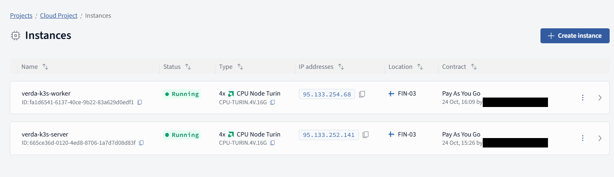
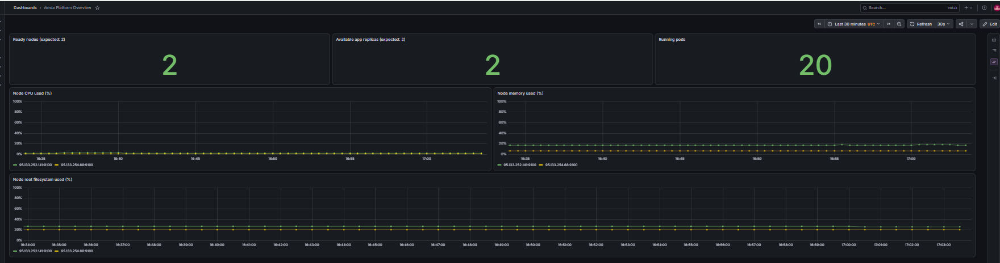
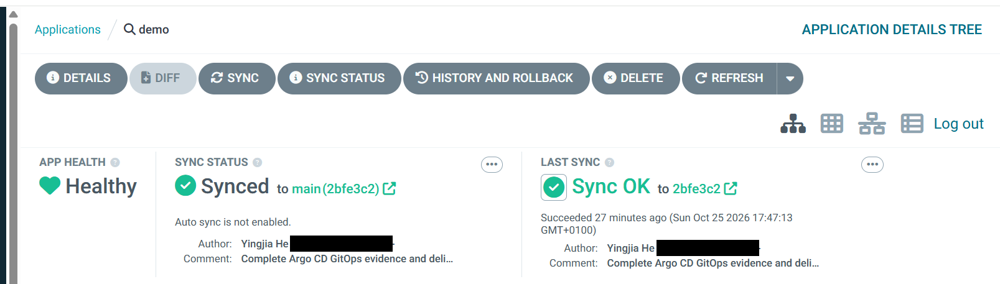
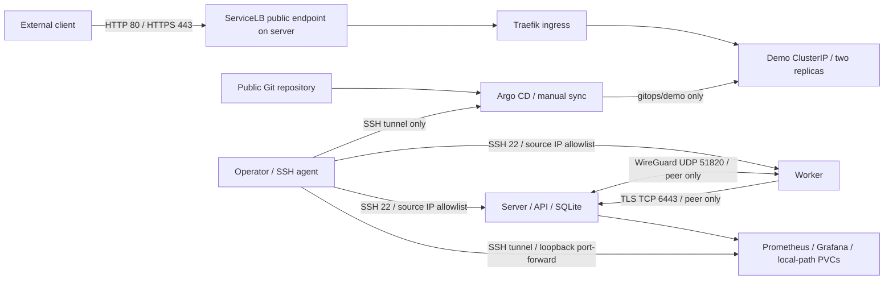

# Verda Kubernetes platform assignment

Two existing Ubuntu VMs are the target: `verda-k3s-server` (`95.133.252.141`) and
`verda-k3s-worker` (`95.133.254.68`). This repository contains the deployment,
application manifests, monitoring configuration, and operator notes.

**Delivery status — 25 October 2026:** fresh SSH and read-only health checks pass
on both VMs from the retained management Wi-Fi. Both nodes are Ready, the app has
two available replicas, all 15 Prometheus targets are healthy, and Grafana plus
six dashboard source queries return data. HTTP/HTTPS index and plain-text health
checks pass. All 15 checked application/platform manifest objects match live configuration.
The cancelled new-IP grant was withdrawn on both hosts; no rollback timer remains
active for that change. See the [delivery checklist and owner actions](docs/HANDOFF.md),
[validation record](docs/VALIDATION.md) and [summary report](docs/REPORT.md).

## Scope

The required outcome is a two-node k3s cluster, Traefik ingress, metrics-server,
an externally reachable sample application with manifests, a documented TLS
approach, Prometheus/Grafana with a useful dashboard, and access/operations notes.
The bonus [basic RBAC](docs/RBAC.md) is deployed and verified for the demo
namespace. A [simple application alert](docs/ALERTS.md) is loaded and its
evaluation lifecycle verified; external notification delivery is not configured.
The [Argo CD / GitOps bonus](docs/GITOPS.md) is deployed and verified for the
existing app, using manual sync with pruning disabled.
The [backup/recovery notes](docs/BACKUP_RESTORE.md) bonus is documented against
the actual SQLite/local-path layout; backup and restore execution remain untested.

## Demonstration

Owner-provided screenshots show the working platform. The owner personally
logged in to Argo CD and confirmed `demo` was **Healthy / Synced** at commit
**`2bfe3c2`**. That revision is the screenshot's capture-time evidence; subsequent
documentation-only commits do not require another application sync.

Verda: both CPU instances Running, with their names, public IPs and specifications.
Personal email addresses are covered by opaque rectangles.



Grafana: six panels, including two Ready nodes, two available app replicas and
20 running Pods.



Argo CD: `demo`, Healthy, Synced, Sync OK and revision `2bfe3c2`; author emails
are covered. All other screenshot pixels are unchanged.



See [screenshot review and checksums](docs/evidence/screenshot-review.json).

## Architecture and network



Both VMs currently have public addresses; this design does not assume a private
Verda network. Pod traffic is encrypted by Flannel `wireguard-native`. Pod and
Service CIDRs are `10.42.0.0/16` and `10.43.0.0/16`. The host firewall permits
TCP 6443/10250/9100 and UDP 51820 only from the peer VM. Port 9100 is needed for
node-exporter scraping because cross-node traffic to its host-network address
is masqueraded to the source node's IP. SSH currently allows the retained
management source `81.226.0.124/32`. Node preparation preserves approved sources
from the existing policy/address registry and the authenticated SSH connection.
Changing management networks requires a separately authorized additive rule and
fresh-source SSH proof; see the [closed access change](docs/SSH_ACCESS.md).
Public application ports are 80/443. Only the server is labeled eligible for
ServiceLB. Monitoring is ClusterIP only.

The nftables policy owns only `table inet verda_platform`. It also filters public
forwarded traffic so generated Kubernetes NodePorts do not accidentally bypass
the host input filter. It does not flush the host ruleset or replace k3s rules.
ICMP, established connections, and inbound DHCPv4 replies on `eth0` are allowed
so the VM's DHCP address can renew after a reboot. IPv6 application networking is not
configured. Provider firewall rules may further restrict traffic.

## Authenticate from Windows

The only local requirements are Python 3 and Windows OpenSSH. `platform.py` uses
only Python's standard library. It never opens an SSH private key; OpenSSH uses
the configured identity and the owner-managed agent. Host key checking is strict.
Verify new host fingerprints against the provider console before adding them to
`known_hosts`; do not disable host checking.

In an **administrator PowerShell**:

```powershell
Set-Service ssh-agent -StartupType Automatic
Start-Service ssh-agent
```

In the owner's **ordinary PowerShell**, enter the passphrase locally:

```powershell
ssh-add "$env:USERPROFILE\.ssh\verda_assignment"
ssh-add -l
python scripts/platform.py preflight
```

Do not send the passphrase or private key through chat. Do not remove its
passphrase. If the key is loaded but authentication still fails, check the public
key fingerprint and `authorized_keys` through the provider console.

## Read-only review of the existing cluster

For the owner or an already-authorized operator, from the repository root:

```powershell
python scripts/review-health.py
python scripts/review-release.py
```

The first needs working SSH and only reads existing state. It does not redeploy,
restart workloads, inject alerts or read Secret values. The second scans local
Git contents/history and writes a local publication-review record. Neither
publishes the repository. Do not run deployment or alert replay merely to review
the existing cluster.

The optional release scanner and manifest comparison also use **PyYAML** in
the local Python environment; `platform.py` and the health reviewer use the
standard library. `python scripts/review-manifests.py` compares declared fields
using GET requests only and never fetches Secrets. These reviews do not install
dependencies or change the cluster.

`Connection timed out` indicates a transport/reachability problem: check network,
VPN, source-IP allowlisting and SSH service reachability. `Permission denied
(publickey)` is an authentication problem. Do not replace a loaded key, remove
its passphrase or disable host verification to address a TCP timeout.

## Initial deployment / intentional changes

These commands **change the VMs/cluster** and are not routine delivery review.
VM provisioning is external to this repository; scripts expect pre-provisioned
hosts and do not create VMs or provide a Verda provisioning audit trail.

```powershell
python scripts/platform.py preflight
python scripts/platform.py deploy
python scripts/platform.py verify
```

An alternate identity path is supported with `--identity PATH`. Run these commands
under the Windows account that owns the loaded agent key, with authorized network
access. `deploy` first verifies both VM hostnames and authentication. It uploads
only the `manifests/`, `scripts/remote/`, and `platform.json` paths. It refuses to
overwrite an unmanaged k3s installation or an existing active UFW policy.

To resume only workload deployment after initial cluster bootstrap, run
`python scripts/platform.py workloads`. To update project firewall rules with
the same timer and fresh-SSH confirmation, run `python scripts/platform.py firewall`.
To apply only the app manifests and wait for rollout, run `python scripts/platform.py app`.
`python scripts/export-evidence.py .local/evidence/<successful-verify-UTC>` exports
a sanitized hand-in record from a successful verification run.

For each node it installs required packages, checks the WireGuard module, saves
configuration under `/root/verda-platform-backups/`, and arms a five-minute
firewall rollback. A new SSH session must pass before the timer is cancelled.
The server is installed first and the worker joins using the agent credential
transferred through SSH stdin; it is never printed, put in local files, or passed
in command-line arguments. Kubernetes credentials remain on the server.

Versions are pinned in `platform.json` and the monitoring manifest. The k3s
installer verifies the downloaded binary checksum. Its installer-script hash,
installed versions, and resulting image IDs are recorded in local evidence.
Application and chart image tags still depend on the upstream registries;
digest locking and image scanning are follow-up improvements.

## Access

After successful validation:

* App: `http://95.133.252.141/` and `https://95.133.252.141/`.
* Health: `/healthz` returns `200 OK`, `Content-Type: text/plain`, and `ok\n`.
* Kubernetes (authorized owner/operator only): use the SSH identity below, then
  `k3s kubectl get nodes -o wide`.
* Grafana: use the tunnel below, then `http://localhost:3000` and
  `/d/verda-platform/verda-platform-overview`.

Management commands assume an authorized key and source IP. They do not grant
external reviewers access by themselves. No reviewer SSH identity or Grafana
account has been provisioned for sharing. See [handoff options](docs/HANDOFF.md#owner-actions-before-submission).

Run this in a terminal and leave it open:

```powershell
ssh -i "$env:USERPROFILE\.ssh\verda_assignment" -o ExitOnForwardFailure=yes -L 3000:127.0.0.1:3000 root@95.133.252.141 "k3s kubectl -n monitoring port-forward --address=127.0.0.1 svc/monitoring-grafana 3000:80"
```

The owner's initial Grafana user is `admin`. To retrieve its bootstrap password,
run this **in your own terminal**; do not put output in reports, screenshots or
chat. A password changed later in Grafana may differ from the initial Secret;
use your current login in that case.

```powershell
ssh -i "$env:USERPROFILE\.ssh\verda_assignment" root@95.133.252.141 "k3s kubectl -n monitoring get secret grafana-admin -o jsonpath='{.data.admin-password}' | base64 -d"
```

Prometheus can be accessed through a separate terminal:

```powershell
ssh -i "$env:USERPROFILE\.ssh\verda_assignment" -o ExitOnForwardFailure=yes -L 9090:127.0.0.1:9090 root@95.133.252.141 "k3s kubectl -n monitoring port-forward --address=127.0.0.1 svc/monitoring-prometheus 9090:9090"
```

The custom six-panel dashboard covers ready nodes, available app replicas,
running pods, node CPU, memory, and root filesystem usage. The chart disables
unavailable k3s control-plane scrape targets to avoid presenting expected missing
endpoints as monitoring failures.

## Argo CD and application GitOps

Repository: **https://github.com/evelyn32h/verda-platform-assignment** (`main`).
Argo CD **v3.5.6** manages only the seven objects in `gitops/demo/app.yaml`.
Namespace, Secrets, monitoring and RBAC stay outside this Application; TLS uses
the existing management workflow. The first manual adoption and the HTML-only
commit `9998ec8` both reached **Synced / Healthy**, with no app/monitoring Pod
replacement or restart. Public HTTP/HTTPS serves the Git-delivered page.

Automatic sync, self-heal and prune remain disabled. Each app resource also has
`Prune=false,Delete=false`; the Application has no cascading deletion finalizer.
Legacy `platform.py app` refuses an adopted app, and the workload script skips its
old application manifest. Use the GitOps source for changes; the old app YAML is
a recovery reference. Routine checks and a future explicit sync are:

```powershell
python scripts/gitops.py verify
python scripts/review-github.py
# After an intentional Git commit/push; this changes the app through Argo:
python scripts/gitops.py sync --revision (git rev-parse HEAD)
```

Argo's UI has no public Ingress or external Service. Leave this SSH tunnel open:

```powershell
ssh -i "$env:USERPROFILE\.ssh\verda_assignment" -o ExitOnForwardFailure=yes -L 127.0.0.1:8080:127.0.0.1:18443 root@95.133.252.141 "k3s kubectl -n argocd port-forward --address=127.0.0.1 svc/argocd-server 18443:443"
```

Open **https://localhost:8080** (Argo's default self-signed UI certificate warns).
User `admin` can retrieve the initial password in the owner's own terminal as
described in [GitOps access, operation and rollback](docs/GITOPS.md). The automated
check fetched UI HTML/version through a temporary SSH tunnel and cleaned it;
the automated check did not log in. The owner subsequently logged in and confirmed
`demo` Healthy/Synced at `2bfe3c2`, as shown in the [demonstration](#demonstration).
No administrator credential is in Git.
See [GitOps evidence](docs/evidence/gitops-checks.json).

## Basic RBAC

The `demo-reader` ServiceAccount is bound to a namespace-local read-only Role:
Pods, Services and Deployments allow `get/list/watch`; Pod logs allow `get`.
It cannot mutate resources, read Secrets, access other namespaces or read cluster
resources. No long-lived credential or public API exposure was added. The app's
own ServiceAccount selection is unchanged.

```powershell
python scripts/rbac.py apply
python scripts/rbac.py verify
```

See [policy and usage](docs/RBAC.md), [YAML](manifests/rbac.yaml) and the
[92-check verification record](docs/evidence/rbac-checks.json). Both the app and
monitoring passed before/after availability checks without a Pod restart/rollout.
`apply` changes the RBAC objects; `verify` only checks existing authorization.

## Simple application alert

`DemoAvailableReplicasLow` warns when `demo/demo` has fewer than two available
replicas continuously for **2 minutes**, evaluated every 15 seconds. The rule's
annotations explain checking readiness, logs/events and node capacity, and
rolling back a faulty release. It reuses Prometheus Operator and the existing
Prometheus instance; Alertmanager remains disabled and no external messages are sent.

```powershell
python scripts/alerts.py apply-test
```

The [rule YAML](manifests/alerts.yaml), [runbook](docs/ALERTS.md) and
[verification evidence](docs/evidence/alert-checks.json) cover actual loading,
a harmless synthetic Pending → Firing → Inactive test, cleanup and unchanged
application/monitoring health. This validates triggering, not notification delivery.
`apply-test` temporarily changes rules: it is proof replay, not a read-only health
check, and is not needed for routine submission review.

## TLS approach

For the assignment's allowed "cert-manager **or explanation of TLS approach**"
option, TLS terminates at Traefik using an explicit self-signed certificate with
both VM IP SANs, valid for 30 days. The private key remains root-only on the server
and in an encrypted-at-rest Kubernetes Secret. Traefik's default TLSStore selects
the same certificate for clients connecting by IP without SNI. HTTP remains
available for the demonstration; no sensitive application data is served.

Browsers will warn until the certificate is explicitly trusted. The remote
validation uses `curl --cacert /etc/verda-platform/tls/demo.crt`; it does not use
`-k`. To verify from a local machine, copy **only the public certificate**:

```powershell
scp -i "$env:USERPROFILE\.ssh\verda_assignment" root@95.133.252.141:/etc/verda-platform/tls/demo.crt .local/demo-public.crt
curl.exe --cacert .local/demo-public.crt https://95.133.252.141/healthz
```

This is an explicitly documented demo tradeoff, not publicly trusted automated
certificate management. For production use a controlled DNS name, cert-manager
and ACME, renewal monitoring, and HTTP-to-HTTPS redirection.

## Operations, rollback, and limitations

See [operations and rollback](docs/OPERATIONS.md) and the [summary report](docs/REPORT.md).
Raw execution evidence is timestamped under `.local/evidence/` and excluded from
Git; it can contain network and operational metadata. Do not publish it blindly.
The concise, sanitized validation document is suitable for the hand-in.

References: [k3s networking](https://docs.k3s.io/installation/requirements),
[WireGuard backend](https://docs.k3s.io/networking/basic-network-options),
[Helm controller](https://docs.k3s.io/add-ons/helm),
[monitoring chart](https://github.com/prometheus-community/helm-charts/tree/main/charts/kube-prometheus-stack),
[Windows agent](https://learn.microsoft.com/en-us/windows-server/administration/openssh/openssh_keymanagement).
