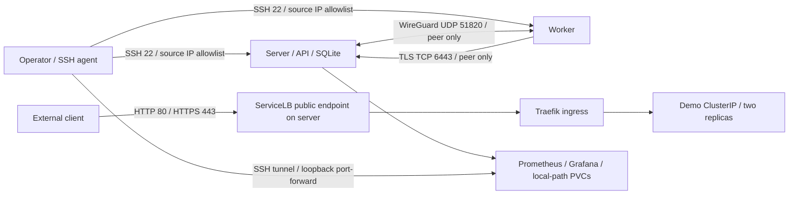

# Verda Kubernetes platform assignment

Two existing Ubuntu VMs are the target: `verda-k3s-server` (`95.133.252.141`) and
`verda-k3s-worker` (`95.133.254.68`). This repository contains the deployment,
application manifests, monitoring configuration, and operator notes.

**Current state:** both VMs authenticated through the owner's SSH agent and the
required platform is deployed. The two-node cluster, external HTTP/HTTPS,
metrics-server, Prometheus and Grafana passed live validation. See the complete
[validation record](docs/VALIDATION.md) and [summary report](docs/REPORT.md).

## Scope

The required outcome is a two-node k3s cluster, Traefik ingress, metrics-server,
an externally reachable sample application with manifests, a documented TLS
approach, Prometheus/Grafana with a useful dashboard, and access/operations notes.
The bonus [basic RBAC](docs/RBAC.md) is deployed and verified for the demo
namespace. GitOps/Argo CD and alerting remain excluded.
The [backup/recovery notes](docs/BACKUP_RESTORE.md) bonus is documented against
the actual SQLite/local-path layout; backup and restore execution remain untested.

## Architecture and network



Both VMs currently have public addresses; this design does not assume a private
Verda network. Pod traffic is encrypted by Flannel `wireguard-native`. Pod and
Service CIDRs are `10.42.0.0/16` and `10.43.0.0/16`. The host firewall permits
TCP 6443/10250/9100 and UDP 51820 only from the peer VM. Port 9100 is needed for
node-exporter scraping because cross-node traffic to its host-network address
is masqueraded to the source node's IP. SSH is limited to the IPv4
address observed in the authenticated `SSH_CONNECTION`; reconfigure it before
changing your management network. Public application ports are 80/443. Only the
server is labeled eligible for ServiceLB. Monitoring is ClusterIP only.

The nftables policy owns only `table inet verda_platform`. It also filters public
forwarded traffic so generated Kubernetes NodePorts do not accidentally bypass
the host input filter. It does not flush the host ruleset or replace k3s rules.
ICMP, established connections, and inbound DHCPv4 replies on `eth0` are allowed
so the VM's DHCP address can renew after a reboot. IPv6 application networking is not
configured. Provider firewall rules may further restrict traffic.

## Authenticate from Windows

The only local requirements are Python 3 and Windows OpenSSH. `platform.py` uses
only Python's standard library. It never opens an SSH private key; OpenSSH uses
the configured identity and the owner-managed agent. Host key checking is strict.
Verify new host fingerprints against the provider console before adding them to
`known_hosts`; do not disable host checking.

In an **administrator PowerShell**:

```powershell
Set-Service ssh-agent -StartupType Automatic
Start-Service ssh-agent
```

In the owner's **ordinary PowerShell**, enter the passphrase locally:

```powershell
ssh-add "$env:USERPROFILE\.ssh\verda_assignment"
ssh-add -l
python scripts/platform.py preflight
```

Do not send the passphrase or private key through chat. Do not remove its
passphrase. If the key is loaded but authentication still fails, check the public
key fingerprint and `authorized_keys` through the provider console.

## Deploy and verify

```powershell
python scripts/platform.py preflight
python scripts/platform.py deploy
python scripts/platform.py verify
```

An alternate identity path is supported with `--identity PATH`. Run these commands
under the Windows account that owns the loaded agent key, with authorized network
access. `deploy` first verifies both VM hostnames and authentication. It uploads
only the `manifests/`, `scripts/remote/`, and `platform.json` paths. It refuses to
overwrite an unmanaged k3s installation or an existing active UFW policy.

To resume only workload deployment after initial cluster bootstrap, run
`python scripts/platform.py workloads`. To update project firewall rules with
the same timer and fresh-SSH confirmation, run `python scripts/platform.py firewall`.
To apply only the app manifests and wait for rollout, run `python scripts/platform.py app`.
`python scripts/export-evidence.py .local/evidence/<successful-verify-UTC>` exports
a sanitized hand-in record from a successful verification run.

For each node it installs required packages, checks the WireGuard module, saves
configuration under `/root/verda-platform-backups/`, and arms a five-minute
firewall rollback. A new SSH session must pass before the timer is cancelled.
The server is installed first and the worker joins using the agent credential
transferred through SSH stdin; it is never printed, put in local files, or passed
in command-line arguments. Kubernetes credentials remain on the server.

Versions are pinned in `platform.json` and the monitoring manifest. The k3s
installer verifies the downloaded binary checksum. Its installer-script hash,
installed versions, and resulting image IDs are recorded in local evidence.
Application and chart image tags still depend on the upstream registries;
digest locking and image scanning are follow-up improvements.

## Access

After successful validation:

* App: `http://95.133.252.141/` and `https://95.133.252.141/`.
* Health: `/healthz` returns `200 OK`, `Content-Type: text/plain`, and `ok\n`.
* Kubernetes: `ssh root@95.133.252.141`, then `k3s kubectl get nodes -o wide`.
* Grafana: use the tunnel below, then `http://localhost:3000` and
  `/d/verda-platform/verda-platform-overview`.

Run this in a terminal and leave it open (use `-i` if the identity is not selected
by your SSH configuration):

```powershell
ssh -i "$env:USERPROFILE\.ssh\verda_assignment" -o ExitOnForwardFailure=yes -L 3000:127.0.0.1:3000 root@95.133.252.141 "k3s kubectl -n monitoring port-forward --address=127.0.0.1 svc/monitoring-grafana 3000:80"
```

Grafana user is `admin`. To retrieve its generated password, run the following
**in your own terminal**, without pasting the output into reports or chat:

```powershell
ssh -i "$env:USERPROFILE\.ssh\verda_assignment" root@95.133.252.141 "k3s kubectl -n monitoring get secret grafana-admin -o jsonpath='{.data.admin-password}' | base64 -d"
```

Prometheus can be accessed through a separate terminal:

```powershell
ssh -i "$env:USERPROFILE\.ssh\verda_assignment" -o ExitOnForwardFailure=yes -L 9090:127.0.0.1:9090 root@95.133.252.141 "k3s kubectl -n monitoring port-forward --address=127.0.0.1 svc/monitoring-prometheus 9090:9090"
```

The custom six-panel dashboard covers ready nodes, available app replicas,
running pods, node CPU, memory, and root filesystem usage. The bundled dashboards
are also provisioned. The chart disables unavailable k3s control-plane scrape
targets to avoid presenting expected missing endpoints as monitoring failures.

## Basic RBAC

The `demo-reader` ServiceAccount is bound to a namespace-local read-only Role:
Pods, Services and Deployments allow `get/list/watch`; Pod logs allow `get`.
It cannot mutate resources, read Secrets, access other namespaces or read cluster
resources. No long-lived credential or public API exposure was added. The app's
own ServiceAccount selection is unchanged.

```powershell
python scripts/rbac.py apply
python scripts/rbac.py verify
```

See [policy and usage](docs/RBAC.md), [YAML](manifests/rbac.yaml) and the
[92-check verification record](docs/evidence/rbac-checks.json). Both the app and
monitoring passed before/after availability checks without a Pod restart/rollout.

## TLS approach

For the assignment's allowed "cert-manager **or explanation of TLS approach**"
option, TLS terminates at Traefik using an explicit self-signed certificate with
both VM IP SANs, valid for 30 days. The private key remains root-only on the server
and in an encrypted-at-rest Kubernetes Secret. Traefik's default TLSStore selects
the same certificate for clients connecting by IP without SNI. HTTP remains
available for the demonstration; no sensitive application data is served.

Browsers will warn until the certificate is explicitly trusted. The remote
validation uses `curl --cacert /etc/verda-platform/tls/demo.crt`; it does not use
`-k`. To verify from a local machine, copy **only the public certificate**:

```powershell
scp -i "$env:USERPROFILE\.ssh\verda_assignment" root@95.133.252.141:/etc/verda-platform/tls/demo.crt .local/demo-public.crt
curl.exe --cacert .local/demo-public.crt https://95.133.252.141/healthz
```

This is an explicitly documented demo tradeoff, not publicly trusted automated
certificate management. For production use a controlled DNS name, cert-manager
and ACME, renewal monitoring, and HTTP-to-HTTPS redirection.

## Operations, rollback, and limitations

See [operations and rollback](docs/OPERATIONS.md) and the [summary report](docs/REPORT.md).
Raw execution evidence is timestamped under `.local/evidence/` and excluded from
Git; it can contain network and operational metadata. Do not publish it blindly.
The concise, sanitized validation document is suitable for the hand-in.

References: [k3s networking](https://docs.k3s.io/installation/requirements),
[WireGuard backend](https://docs.k3s.io/networking/basic-network-options),
[Helm controller](https://docs.k3s.io/add-ons/helm),
[monitoring chart](https://github.com/prometheus-community/helm-charts/tree/main/charts/kube-prometheus-stack),
[Windows agent](https://learn.microsoft.com/en-us/windows-server/administration/openssh/openssh_keymanagement).
